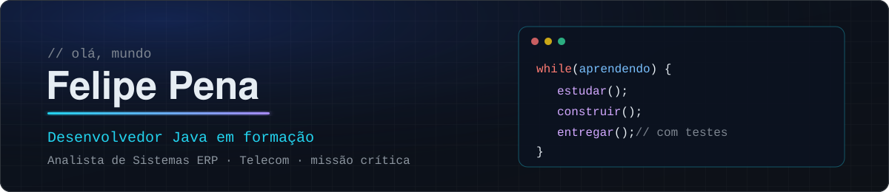

<p align="center">
  
</p>

<p align="center">
  
  
  
  
  
  
  
  
</p>

## Olá, eu sou o Felipe Pena 👋

Analista de Sistemas ERP no segmento de Telecom, atuando em ambientes de missão crítica na sustentação de sistemas corporativos, entre monólitos e microsserviços na Azure.

### Atuação

• Atuação na análise detalhada e resolução de incidentes complexos em ambientes de missão crítica (Telecom), garantindo a estabilidade, performance e continuidade dos serviços.
• Análises em servidores Linux/HP-UX, utilizando Shell script é PowerShell.
• Execução de testes funcionais, validações e homologações de APIs/WebServices utilizando Postman e SoapUI em suporte a novos deploys e implantações.
• Análise de causa raiz de erros de aplicação e banco de dados através do mapeamento de logs e consultas estruturadas em bancos Oracle (SQL e PL/SQL).
• Interação direta com equipes multidisciplinares de Engenharia, Infraestrutura e fornecedores para prevenção e mitigação de problemas sob a metodologia ágil (Scrum).
• Criação de documentação técnica de sistemas, mapeamento de requisitos de software e desenvolvimento de visões operacionais (dashboards) no ServiceNow seguindo práticas ITIL.
• Orientação técnica de estagiários.
• Azure, AWS.

Em paralelo, estudo desenvolvimento Java e engenharia de software, aplicados em projetos próprios.

```java
public record Foco(String agora, String proximo) {}

var foco = new Foco(
    "APIs REST com Design First, segurança e entrega contínua",
    "Arquitetura de software e cloud"
);
```

### 🔧 Stack

**Backend:** Java · Spring Boot · Spring Security · JPA · Flyway<br>
**Segurança:** JWT · OAuth 2.0 · OpenID Connect · MFA<br>
**Frontend:** React · TypeScript · Vite · TanStack Query<br>
**Dados:** PostgreSQL<br>
**Qualidade e entrega:** JUnit · Mockito · Vitest · SonarQube · GitHub Actions · Docker

### 🚀 Projeto em destaque

**[AppRH](https://github.com/felipee-pena/AppRH)**: plataforma de recrutamento full stack com arquitetura em camadas, roles e ownership, login com Google, MFA, e-mails transacionais, pipelines de CI com imagem Docker e decisões documentadas em ADRs.

### 📚 Estudando agora

- AWS
- Pós-graduação em Arquitetura e Desenvolvimento Java (a partir de 2027)

### 📫 Contato

[LinkedIn](https://www.linkedin.com/in/felipe-pena-8a31621a6)
[E-mail](fehdacp@gmail.com)
